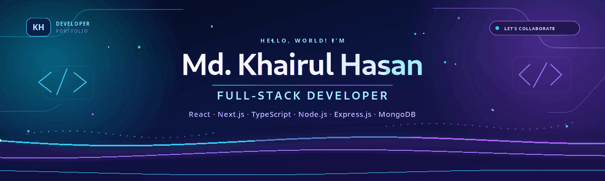

<!-- PREMIUM ANIMATED GITHUB PROFILE HEADER -->
<!-- Theme: Dark Navy + Purple + Cyan -->

  <!-- Animated Neon Wave Header -->
  

  <!-- Smooth Looping Typing Animation -->

# 💫 About Me:

👋 Hi, I’m Md Khairul Hasan 🖥️ I’m currently working on React.js, Next.js,
and TypeScript for frontend development. 🗄️ I'm using Node.js, Express.js,
and MongoDB for the backend. 🛠️ I’m currently learning Nest.js, PostgreSQL,
Redis, Docker, and AWS. 💬 Ask me about Full-Stack (React, Node, Express,
MongoDB). 📫 Feel free to reach out to me via
[email](mailto:mdkhairulhasan344@gmail.com)

## <b> Follow me on Socials:</b>

<!--- common technology --->

## <b>Common Technology Stack:</b>

<!--- main technology --->

## <b>Main Technology Stack:</b>

### Languages:

### CSS Frameworks & Libraries:

### JavaScript Frameworks & Libraries:

### Database & Model:

### Deployment Platform:

### Design & Graphics:

### Tools & Technologies:

 

## <b> Github Statistics & Analysis:</b>

## 🐍 My Contribution Snake

  <picture>
    <source
      media="(prefers-color-scheme: dark)"
      srcset="https://raw.githubusercontent.com/MdKhairulHassan/MdKhairulHassan/output/grid-dark.svg"
    />
    <source
      media="(prefers-color-scheme: light)"
      srcset="https://raw.githubusercontent.com/MdKhairulHassan/MdKhairulHassan/output/grid.svg"
    />
    
  </picture>

 
 

## <b> Random Dev Quote:</b>

## 🏆 GitHub Trophies

### 🔝 Top Contributed Repo

<!-- PREMIUM COMPACT HORIZONTAL FOOTER -->
<!-- Theme: Dark Navy + Purple + Cyan -->

  <h3>💬 My Motto</h3>

  

    <em><strong>
      ✨ "Dream beyond limits, code with passion, and turn ideas into reality." ✨
    </strong></em>
  

  

    
    
    
  

  
    📍 Dhaka, Bangladesh &nbsp; • &nbsp;
    💻 Code with Passion &nbsp; • &nbsp;
    🚀 Build with Purpose
  

---

<!-- Proudly created with GPRM ( https://gprm.itsvg.in ) -->
